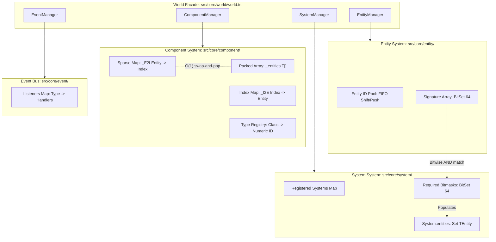
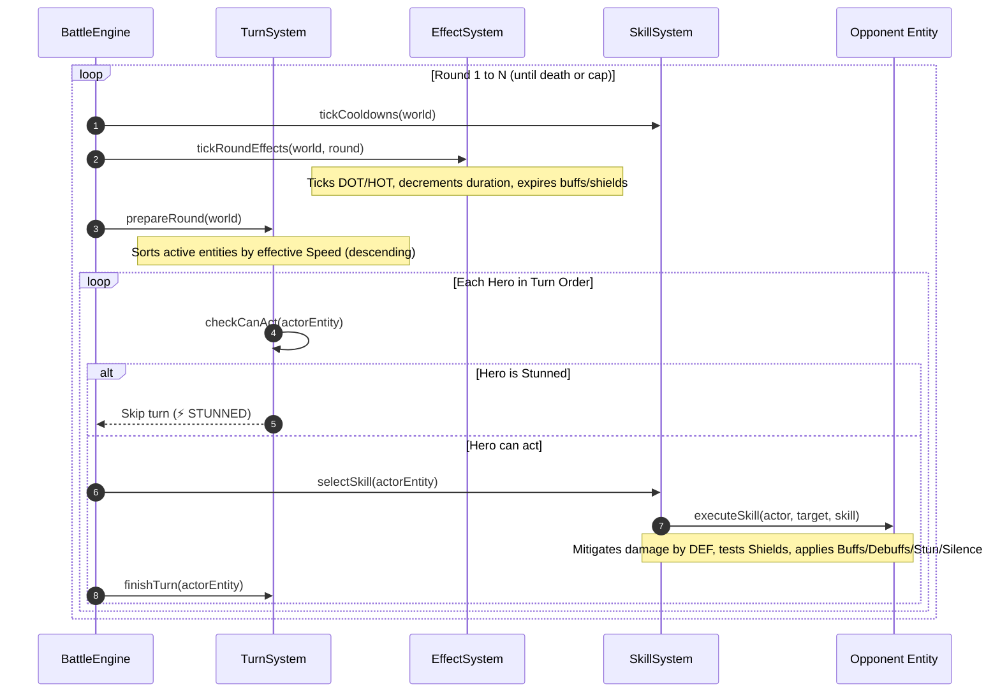

# ECS Core Analysis & Turn-Based Battle Simulator Summary

## 1. ECS Core System Architecture (`src/core/`)

The ECS engine in `src/core/` implements a dense packed-array architecture with bitmask signatures, coordinated by a `World` facade.



### Core Subsystems

| Module | Core Classes | Data Structures | Responsibilities |
|---|---|---|---|
| `src/core/entity` | `EntityManager` | `_entities: number[]`<br>`_signatures: BitSet[]`<br>`_alive: Set<number>` | • Recycled entity ID allocator (`create`/`destroy`).<br>• Tracks component signatures via 64-bit `BitSet`. |
| `src/core/component` | `Component<T>`<br>`ComponentManager` | `_entities: T[]`<br>`_E2I: Map<Entity, Index>`<br>`_I2E: Map<Index, Entity>`<br>`_types: Map<Ctor, number>` | • Packed array storage with swap-and-pop removal in $O(1)$.<br>• Dense contiguous memory representation without gaps.<br>• Dynamic numeric component type registration. |
| `src/core/system` | `System`<br>`SystemManager` | `_systems: Map<Ctor, System>`<br>`_signatures: Map<Ctor, BitSet>`<br>`entities: Set<TEntity>` | • Abstract base requiring `init()` and `update(dt)`.<br>• System matching: `(entitySig & systemSig) === systemSig`.<br>• Automatically manages `entities` set per system. |
| `src/core/event` | `Event<T>`<br>`EventManager<T>` | `_data: Map<TId, any>`<br>`_listeners: Map<TId, TFunc[]>` | • Decoupled event bus with typed IDs and synchronous callbacks. |
| `src/core/world` | `World<TEvents>` | `Unique<EntityManager>`<br>`Unique<ComponentManager>`<br>`Unique<SystemManager>`<br>`Unique<EventManager>` | • Unified coordinator for entities, components, systems, and events.<br>• Handles cascaded destruction and bitmask query filtering. |

---

## 2. 2-Hero Turn-Based Battle Simulator (`src/test/`)

The simulator implements a turn-based combat engine between two asymmetric heroes:

```
src/test/
├── types.ts                     # Battle events, skill definitions, active effect definitions
├── components/
│   ├── hero.component.ts        # HP, ATK, DEF, SPD, Energy, Alive state
│   ├── skill.component.ts       # Equipped skills & cooldown tracking
│   ├── effect.component.ts      # Active status effects, buffs, debuffs, shields
│   ├── turn.component.ts        # Turn order flag, stun/silence status
│   └── index.ts
├── systems/
│   ├── effect.system.ts         # Handles DOT, HOT, Buffs/Debuffs, Shield absorption, expiry
│   ├── skill.system.ts          # AI skill selection, mitigation, damage, stun/silence application
│   ├── turn.system.ts           # Speed-based turn ordering, round reset, Stun skips
│   ├── battle.engine.ts         # Simulation orchestrator & combat logger
│   └── index.ts
└── index.ts                     # Executable entry point
```

### Sequence Flow



### Combat Mechanics & Rules

- **Turn Order**: Determined at round start by sorting active heroes by effective `Speed` descending.
- **Damage Formula**:
  $$\text{Damage} = \max\left(1, \operatorname{round}\left(\text{Attack} \times \text{Multiplier} \times \frac{100}{100 + \text{Defense}}\right)\right)$$
- **Shield Absorption**: Shields absorb damage directly before health is depleted.
- **Status Effects**:
  - `DOT`: Inflicts direct damage at start of round (e.g. Burn).
  - `HOT`: Restores health at start of round.
  - `BUFF`/`DEBUFF`: Dynamic percentage adjustments to Attack, Defense, and Speed.
  - `STUN`: Skips the target's action for the round.
  - `SILENCE`: Forbids casting energy-cost skills (forces basic attack).
- **Energy Generation**:
  - Basic Attack: +25 Energy.
  - Special Attack: +10 Energy.
  - Taking Damage: +15 Energy.

---

## 3. Build & Run Errors: Root Cause Analysis & Resolution

### Error 1: `'tsc-alias' is not recognized as an internal or external command`
- **Cause**: `package.json` had `"build": "tsc && tsc-alias"`, but `tsc-alias` was not listed in `devDependencies`.
- **Fix**: Installed `tsc-alias` via `npm i -D tsc-alias`.

### Error 2: `World.add_component` Constructor Argument Mismatch
- **Cause**: `World.add_component` and `ComponentManager.add` were updated to construct components internally via `new _class(..._param)`. Passing already instantiated objects (`new HeroComponent(...)`) passed the object as the first parameter to the constructor rather than the arguments tuple.
- **Fix**: Updated calls in `BattleEngine.spawnHeroes` to pass constructor arguments directly:
  ```ts
  this.world.add_component(this.hero1Entity, HeroComponent, {
      name: "Ignis (Pyromancer)",
      team: "RED",
      hp: 420,
      attack: 68,
      defense: 22,
      speed: 35,
      initialEnergy: 20
  });
  this.world.add_component(this.hero1Entity, SkillComponent, ignisSkills);
  this.world.add_component(this.hero1Entity, EffectComponent);
  this.world.add_component(this.hero1Entity, TurnComponent);
  ```

### Error 3: Test Generation & Execution under `dtest/`
- **Requirement**: `npm test` must compile scripts into `dtest/` and execute the compiled script inside it.
- **Fix**:
  1. Added `dtest/` to `.gitignore`.
  2. Configured `npm test` script in `package.json` to compile to `dtest/`, run `tsc-alias -f` to resolve aliases and relative `.js` extensions for native Node ESM, and execute `node ./dtest/test/index.js`:
     ```json
     "scripts": {
         "test": "tsc --outDir ./dtest && tsc-alias --dir ./dtest -f && node ./dtest/test/index.js",
         "build": "tsc && tsc-alias -f",
         "start": "node ./dist/test/index.js",
         "check": "tsc --noEmit"
     }
     ```

---

## 4. Deterministic RNG & Pre-Calculation Workflow

1. **Seed Generation (`Xorshift128p`)**:
   Generates two 64-bit entropy seeds using high-resolution timestamps and `Xorshift128p`:
   ```ts
   const [s0, s1] = generateBattleSeed();
   ```
2. **RNG Influence on Combat**:
   - **Critical Strikes**: 20% base chance to land 1.5x damage.
   - **Damage Variance**: $\pm 5\%$ damage fluctuation via `0.95 + rng.float * 0.10`.
   - **Effect Proc / Resist**: Skills have chance-to-apply rates (e.g. 85%–95%).
   - **Initiative Roll**: Speed tie-breaking via initiative roll bonus.
3. **Two-Pass Execution Guarantee**:
   - **Pass 1 (Pre-Calculation)**: Runs headless simulation with zero logging using `new Xorshift128p(s0, s1)` to project final winner, rounds, and remaining HP.
   - **Pass 2 (Enactment & Logging)**: Logs the pre-calculated projection in Round 0, then replays the combat sequence with an identical RNG sequence `new Xorshift128p(s0, s1)`, guaranteeing a 100% match with the logged prediction.

---

## 5. Verification Commands

```bash
# Compiles to ./dtest/ and executes the compiled battle simulation via node
npm test

# Type-check TypeScript sources
npm run check

# Compiles to ./dist/
npm run build
```
